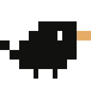

<picture>
<source media="(prefers-color-scheme: dark)" srcset=".github/bird-dark.svg">

</picture>

<samp>
---                       
name: pele-rs             
description: port of pele 
author: autistic.computer 
license: mit              
version: 0.1.0            
---                      
</samp>

<a href="https://autistic.computer"><kbd> /{&gt; autistic.computer </kbd></a>

